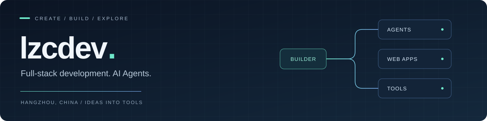

  

  <strong>从全栈应用到 Agent 工程，把问题复现、修复和验证连起来。</strong>

  <a href="https://www.lzcdev.top">Blog</a> ·
  <a href="https://github.com/search?q=author%3Alzcdev+is%3Apr+-user%3Alzcdev&type=pullrequests">Open-source contributions</a> ·
  <a href="https://github.com/lzcdev?tab=repositories">Projects</a>

 

### 01 / About

我是 lzcdev，来自杭州，关注 **Agent、RAG 与全栈应用开发**。

过去做 Web 和 iOS，现在把更多精力放在 Agent 工程与开源协作上。近期实践集中在文档解析、检索 API 和回归测试：从具体问题出发，阅读源码、构造复现，再提交可以验证的修改。

### 02 / Selected contributions

**Docling · DOCX 表格解析** &nbsp; `Merged`

保留网格定义缺失或列数不足时的表格单元格，兼顾合并单元格和行尾省略列。补充回归用例，314 个 Word 后端测试通过。

[查看 PR #5179 →](https://github.com/docling-project/docling/pull/5179)

**RAGFlow · 图片 OCR 文本恢复** &nbsp; `Open PR`

恢复 Docling 图片子节点中的 OCR 文本，保持阅读顺序和位置信息，避免重复引用说明文字。基于模拟响应验证修复前失败、修复后通过，解析器测试通过。

[查看 PR #22122 →](https://github.com/infiniflow/ragflow/pull/22122)

**RAGFlow · Go API 知识图谱检索** &nbsp; `Open PR`

通过 `use_kg` 按需返回实体、关系和来源 chunk ID，限制在授权数据集及选定文档范围内。覆盖按需返回、越界文档和空过滤范围，service 与 handler 测试通过。

[查看 PR #22368 →](https://github.com/infiniflow/ragflow/pull/22368)

状态核实于 2026-11-24，最新进展以 PR 页面为准。上述 RAGFlow Go 测试使用 CGO_ENABLED=0；OCR 验证使用模拟服务响应。

### 03 / Learning & projects

| 仓库 | 内容 |
| :--- | :--- |
| [**agent_study**](https://github.com/lzcdev/agent_study) | Agent 学习路线与实践规划，覆盖工具调用、RAG、多 Agent 协作、可观测与评测。当前作为学习记录持续整理。 |
| [**BaiDuBaiKeSpider**](https://github.com/lzcdev/BaiDuBaiKeSpider) | Python 百度百科爬虫项目，记录早期的数据采集实践。 |
| [**ReadingNotes**](https://github.com/lzcdev/ReadingNotes) | 计算机系统、网络和软件开发相关的读书笔记。 |

### 04 / Engineering focus

**Agent & RAG** — 工具调用 · 文档解析 · 检索上下文 · 知识图谱 
**Development** — Python · Go · TypeScript · React 
**Collaboration** — 问题复现 · 回归测试 · Pull requests · Code review

 

---

  Hangzhou, China · <a href="https://www.lzcdev.top">www.lzcdev.top</a> · Build, verify, improve.

